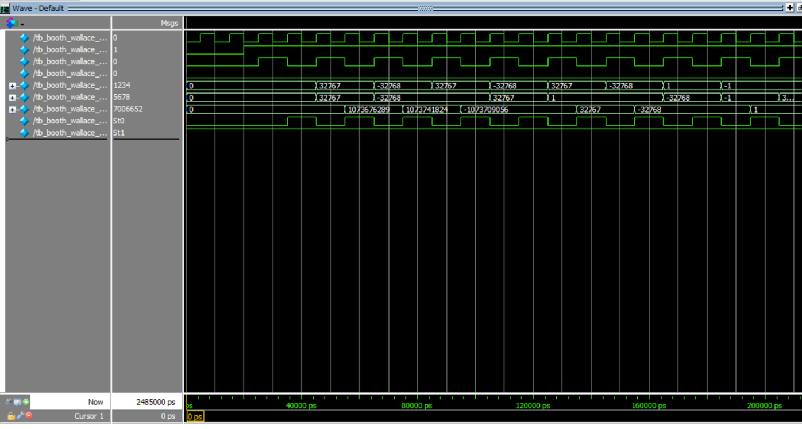
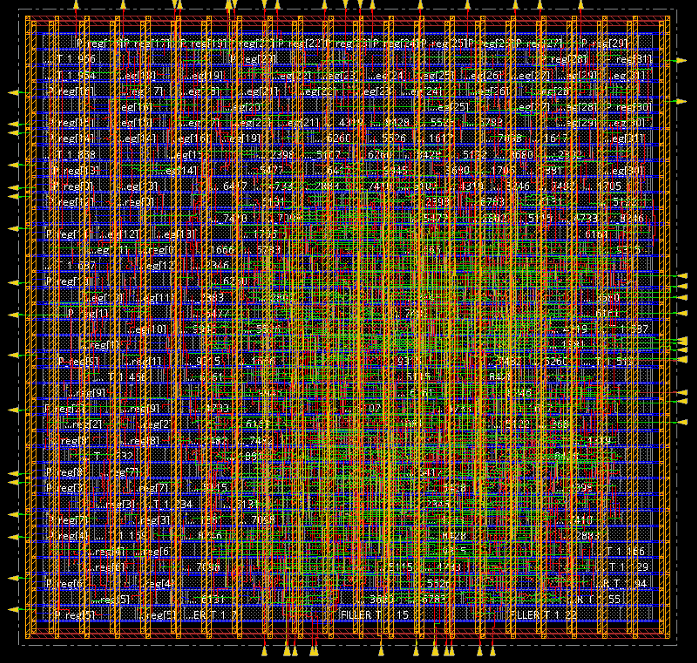
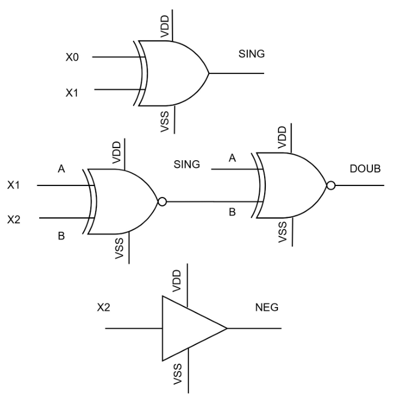
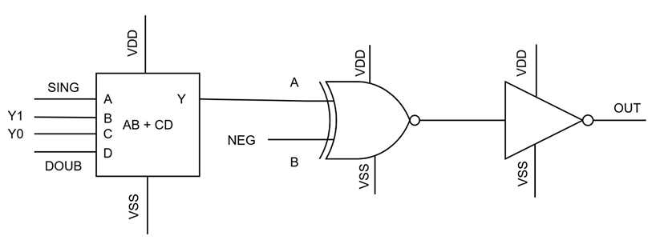

# 16-bit Signed/Unsigned Pipelined Radix-4 Booth Multiplier

A low-power multiplier design combining Radix-4 Booth encoding, Wallace-tree partial-product reduction, pipelining, and power gating.

## Project Overview

This project explores the design and implementation of a 16-bit signed/unsigned pipelined Radix-4 Booth multiplier, covering RTL development, ASIC implementation, and transistor-level circuit design using Cadence tools.

## 1. RTL Design and Verification

- 16-bit signed and unsigned multiplication.
- Radix-4 Booth recoding to reduce partial products.
- Wallace-tree reduction for partial-product compression.
- Three-stage pipelined architecture.
- Functional verification using simulation testbenches.
- Testing across signed, unsigned, mixed-sign, and boundary input cases.

  

## 2. ASIC Implementation

**Tools:** Cadence Genus and Cadence Innovus

Implementation flow:

1. Verilog RTL development.
2. Functional simulation and verification.
3. RTL synthesis and technology mapping.
4. Floorplanning and power planning.
5. Placement and clock tree synthesis.
6. Routing and timing analysis.
7. Physical verification and GDSII generation.

**Technology:** 90 nm CMOS  
**Supply voltage:** 1.8 V

## 3. Cadence Virtuoso Circuit Design

The transistor-level design and schematic simulation covered the major multiplier building blocks:

- Booth encoder and control logic.
- Booth selector and partial-product generation.
- Wallace-tree reduction architecture.
- Power-gating concept using a PMOS header sleep transistor.
- Schematic-level functional simulation.

## 4. Reported Results

The paper reports the following comparison:

| Parameter | Existing Design | Proposed Design |
|---|---:|---:|
| Area (µm²) | 17,590 | 5,651 |
| Power (reported units) | 311.61 | 258.84 |
| Slack (reported ns) | 1353 | 178 |

The reported area reduction is approximately 67.8%, while the reported power reduction is approximately 17%.

*Note: Values are reproduced from the paper's comparison table. Refer to the publication for measurement conditions and units.*

## 5. Research Publication

**Title:** Design of 16-bit Signed and Unsigned Pipelined Radix-4 Booth Multiplier with Power Gating

**Conference:** 2026 IEEE 6th International Conference on VLSI Systems, Architecture, Technology and Applications (VLSI SATA)

**DOI:** [10.1109/VLSISATA69163.2026.11610084](https://doi.org/10.1109/VLSISATA69163.2026.11610084)

## 📸 Design Gallery

### 1. RTL Simulation Waveform
Simulation waveform showing multiplier inputs, outputs, and signal transitions.

### 2. ASIC Physical Layout
Physical implementation layout generated during the ASIC design flow.

### 3. Booth Encoder Schematic
Schematic illustrating the Booth encoder control signals: SING, DOUB, and NEG.

### 4. Partial-Product Selector
Schematic showing the logic used to select and generate partial products.

## Repository Contents

This repository documents the architecture, design methodology, verification approach, implementation flow, and research results. RTL source code and proprietary design files are not included.

## Author

**Sreelakshmi A R**  
M.Tech VLSI Design, VIT Chennai

[GitHub Profile](https://github.com/Sree-R5727)
